This page is for the JSXGraph maintainers. It lists every problem we found
with boards that are created while hidden (a closed tab, a collapsed section,
a hidden iframe) and shown later, ordered by severity. Each problem is
labelled **library** (JSXGraph) or **extension** (the jsxgraph-quarto
extension). Most have a minimal page that reproduces them; each has what
you should see and what you see, the affected versions, the place in the
source, and possible fixes.

Problems 1, 2 and 4, the `functiongraph` crash listed at the end, and the
extension measurements were checked by an independent verification (fresh downloads,
its own test pages and drivers); the numbers given are from it unless a
section says otherwise. Problems 3 and 5 and the two plain-div pages under
problem 1 were found and measured for this page, not by the verification;
the div page and the iframe page of problem 1 were also checked by hand in
Chrome 152 on Windows. Problem 6 was found by reading the code.

The pages in `repro/` load JSXGraph from jsDelivr; add `?v=1.9.1` (or another version)
to a page's address to load that version. Source locations are from our
investigation of tag v1.14.0; the resize code is unchanged on `main`
(55a2035, 19 October 2026).

**Browsers.** On 19 October 2026 the maintainers' desktop setting was checked
by hand in Chrome 152.0.7977.149 on Windows: problem 1 reproduces there in a
normal, visible window with the div page (blank in 4 of 4 loads with
JSXGraph 1.14.0, drawn with 1.9.1), and with the iframe page only while
Chrome is not painting the window (see problem 1). All other measurements on
this page were made in Chromium 141.0.7390.37 on Linux, the full browser that
Chrome is built from, under automation, with a window (under Xvfb) and in
headless mode, except where a section says "checked by hand on Windows
Chrome 152": the repro pages of problems 1 to 4 and the `functiongraph` page
were also opened there in a visible window in front, and each showed the
problem as described. Problem 5 was not checked there. Chromium's separate
"headless shell" never shows problem 1 in iframes. Firefox and Safari were
not available to us, so this page says nothing about them.

**Update, 26 October 2026: JSXGraph 1.14.2.** Measured in automated
Chromium with the pages and drivers used for this update. Problem 2 is fixed
in 1.14.2: a board with `unitX`/`unitY`/`originX`/`originY` created hidden
gets its units and origin when shown, and a bounding box set while a board is
hidden is kept (afe77cfe, 3e5ea5ff, 1096eb30; 1.14.1 still loses both).
Problem 3 is fixed in 1.14.1 and 1.14.2: a hidden `keepaspectratio` board
shows the fitted view when shown. **Problem 5 is still open in 1.14.2**, and
it is wider than first described: the box is cropped whenever the container
gets narrower than the box's aspect ratio, also while the container stays
wider than high. It now has a minimal page,
[keepaspectratio-narrowed.html](repro/keepaspectratio-narrowed.html).
Problems 1, 4 and 6 are listed as fixed in 1.14.1 in the jsxgraph-quarto
extension's notes; they were not measured again for this update. The rest of
this page is the report as of 19 October (JSXGraph 1.14.0).

## Summary

Library (JSXGraph 1.14.0):

::: {.table-responsive}
| # | Problem | Since | Where it shows |
|---|---|---|---|
| [1](#p1) | Resize notifications are dropped; a board shown from a hidden tab can stay blank | 1.9.2 | hidden divs shown while the page is busy (4 of 4 loads in desktop Chrome 152, window in front); hidden sandboxed iframes shown while Chrome is not painting the window (covered, in the background, automated); visible divs resized twice within 10 ms |
| [2](#p2) | Boards with `unitX/unitY/originX/originY` created hidden are broken after showing | 1.3.0 | containers without a CSS pixel size, 0 px wide at creation |
| [3](#p3) | `keepaspectratio` boards created at 0×0 show the wrong region | 1.5.0 | relative sizes in a hidden parent; hidden iframes |
| [4](#p4) | One exception during a resize stops all later resizing | 1.3.1 | any board |
| [5](#p5) | A `keepaspectratio` board narrowed below its box's aspect ratio is cropped (still open in 1.14.2) | 1.5.0 | visible boards too; may be intended |
| [6](#p6r) | Possible endless loop in the SVG renderer for cubic curves with an undefined point | 1.13.2 | found by reading the code, not run |
:::

What works in 1.14.0: a board defined by a `boundingbox` that is created
hidden gets a 0×0 size and a NaN bounding box, throws no error, and when its
container is shown, JSXGraph's ResizeObserver gives it the right size and
view; afterwards it follows narrowing and widening. Problem 1 (timing) and
problem 3 (`keepaspectratio`) are the exceptions; problem 2 concerns boards
defined by units and origin instead.

Extension (jsxgraph-quarto):

::: {.table-responsive}
| # | Problem | Versions |
|---|---|---|
| [7](#p6) | After the first resize, boards no longer follow the window | upstream main 59d549c |
| [8](#p7) | Boards in hidden tabs can stay blank when the tab is opened (problem 1, through the extension's iframes) | a26aea8, 59d549c |
:::

[Pull request #2](https://github.com/jsxgraph/jsxgraph-quarto/pull/2) of
jsxgraph-quarto addresses 7 and 8 on the extension side. Problems fixed in
later JSXGraph releases are listed [at the end](#fixed).

## 1. Library: resize notifications are dropped, so a board can stay blank {#p1}

**What goes wrong.** The board's ResizeObserver callback takes the size from
the first notification, ignores further notifications for 10 ms
(`resize.throttle`), and then applies the size it took. If the container
changes size again within those 10 ms, the board keeps the earlier size. The
observer does not report the same size twice, so nothing corrects it later.
For a board created hidden, the earlier size is 0×0 and the board stays blank.

**Versions:** 1.9.2 to 1.14.0 and `main`. Not 1.9.1 or earlier.

**Reproduce in a visible window** with
[blank-after-quick-show.html](repro/blank-after-quick-show.html). A board in
a div whose parent is `display:none` is shown while JSXGraph's first (0×0)
timer is pending and the page is busy for 30 ms, as other scripts on a page
often are when a tab opens. Open the page; the status line says whether the
board is drawn.

- Chrome 152.0.7977.149 on Windows, window in front, checked by hand:
  JSXGraph 1.14.0 blank in 4 of 4 loads; 1.9.1 drawn in 2 of 2.
- Chromium 141 on Linux, headless, automated: blank in 5 of 8 loads.

::: {.table-responsive}
| You should see (here: shown 500 ms later) | You see (1.14.0) |
|---|---|
| 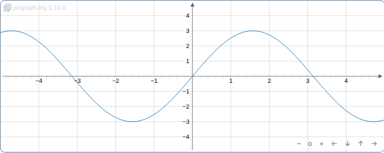 | 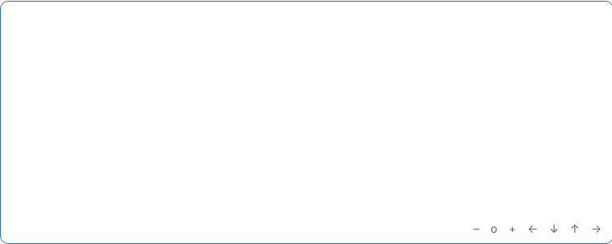 |
:::

**Reproduce with a sandboxed iframe** (as the Quarto extension embeds
boards) with [blank-in-hidden-iframe.html](repro/blank-in-hidden-iframe.html):
a `data:` iframe in a tab that is `display:none` at load. Here the board
stays blank only if Chrome is not painting the window at the moment the tab
opens: the window is covered by another window or in the background, or the
browser is headless or automated. Chrome still reports
`document.hidden = false` in these cases.

1. Open the page and press **Run 20 times automatically**. Each trial shows a
   fresh hidden iframe at the top of the page and reads the board 2 s later.
2. While it runs, cover the browser window with another window for some of
   the trials. The result is "blank in N of 20", with one line per trial.

- Chrome 152.0.7977.149 on Windows, JSXGraph 1.14.0, checked by hand: blank
  in 4 of 20, exactly the trials during which the window was covered; while
  the window was in front, every board was drawn.
- Chromium 141 on Linux under automation: blank in 40 to 63 % of page loads
  (independent verification, table below).
- A blank board stays blank when the tab is hidden and shown again; it
  recovers when the iframe's size changes (narrowing or widening the
  window). Resizing the window while the tab is still hidden prevents the
  problem (0 of 20 loads); a longer wait before the click does not (10 of 20
  after 4.5 s).

::: {.table-responsive}
| You should see | You see (1.14.0, automated Chromium) |
|---|---|
| 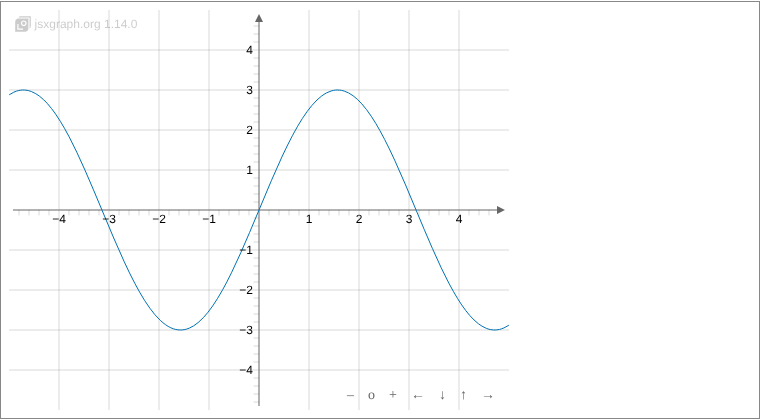 | 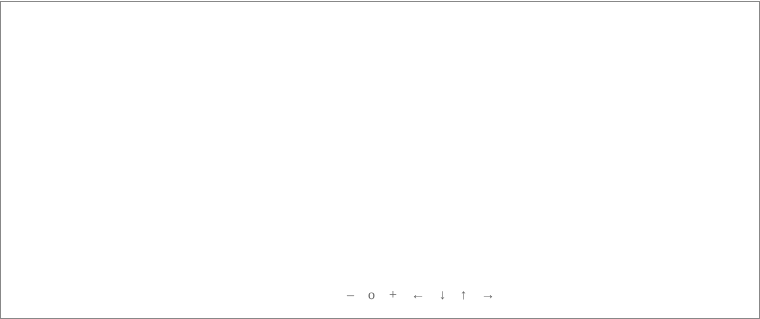 |
:::

Measured by an independent verification in Chromium 141 on Linux, 30 page
loads per cell (tab clicked 0.3 to 0.9 s after the page was ready; pooled,
1.13.3 and 1.14.0 were blank in 120 of 240 loads in the full Chromium, 1.9.1
in 0 of 120):

::: {.table-responsive}
| Browser | 1.9.1 | 1.13.3 | 1.14.0 |
|---|---|---|---|
| Chromium, with a window | 0/30, 0/30 | 13/30, 12/30 | 15/30, 16/30 |
| Chromium, headless | 0/30, 0/30 | 12/30, 18/30 | 19/30, 15/30 |
| Chromium headless shell | 0/30, 0/30 | 0/30, 0/30 | 0/30, 0/30 |
:::

The two numbers per cell are for an iframe with a pixel size and one sized
by `aspect-ratio`.

**A visible board** shows the same defect in
[stale-svg-after-quick-resize.html](repro/stale-svg-after-quick-resize.html):
its container grows from 300 to 400 to 500 px within 10 ms while the page is
busy for 30 ms (press **Run**). Stale in every run in our (automated)
measurements. Checked by hand on Windows Chrome 152 with 1.14.0: stale in
2 of 2 clean page loads (SVG 400 px in a 500 px div); watching the page, the
board did not fill its frame in roughly 70 % of runs. With 1.9.1 the SVG is
500 px (the page allows 1 px for fractional sizes).

::: {.table-responsive}
| You should see (1.9.1) | You see (1.14.0): the SVG stays 400 px wide |
|---|---|
| 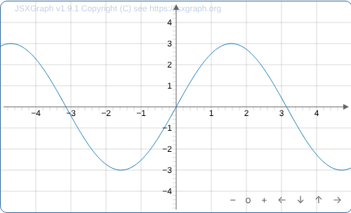 | 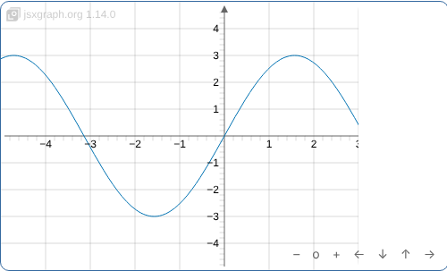 |
:::

All three pages show one defect with one cause and one fix, below.

**Why it happens in iframes.** Chromium does not render a hidden cross-origin
iframe. In the automated runs, when the tab was shown, the iframe first
delivered the observer's pending notification with 0×0 and, 1 to 4 ms later,
the real size. Whether the 0×0 comes first depends on which arrives first in
the iframe, its first rendering update or its new window size. In every one
of the 120 blank runs above, the only call of `updateContainerDims` was
`(0, 0)` while the container had its full size (500×400, or 984×787 with
`aspect-ratio`). Version 1.9.1 receives the same two notifications, but reads
the size when its timer fires, so it gets the real one. The headless shell
does not show the race: there the 0×0 arrives while the tab is still hidden.
In the Windows checks no blank iframe board was seen while the window was in
front; the order of events there was not traced.

**Cause** (source location from our investigation): `src/base/board.js`,
`startResizeObserver`,
[lines 4497–4513](https://github.com/jsxgraph/jsxgraph/blob/v1.14.0/src/base/board.js#L4497-L4513):

```js
this.resizeObserver = new ResizeObserver(function (entries) {
    var bb;
    if (!that._isResizing) {
        that._isResizing = true;
        bb = entries[0].contentRect;          // size of the first notification
        window.setTimeout(function () {
            try {
                that.updateContainerDims(bb.width, bb.height);
            } catch (e) {
                JXG.debug(e);
                that.stopResizeObserver();
            } finally {
                that._isResizing = false;
            }
        }, that.attr.resize.throttle);
    }                                         // later notifications are not used
});
```

This came with commit
[d336a055c](https://github.com/jsxgraph/jsxgraph/commit/d336a055c)
(2024-06-26, "Bug fix: infinitely increasing board with resize observer",
first released in 1.9.2). Before it, the timer read the container's size
when it fired (1.9.1 calls `updateContainerDims()` without arguments). On the
`sketchometry` branch, commit
[66304e689](https://github.com/jsxgraph/jsxgraph/commit/66304e689)
(2025-01-23, "fix resize bug. Dimensions have to be evaluated in timeout.
This issue was registered in sketchometry when re-opening the app.") read the
size in the timer again, with `getBoundingClientRect()`; it was reverted
there on 2025-01-28 in
[9a84579f5](https://github.com/jsxgraph/jsxgraph/commit/9a84579f5), without a
stated reason. Neither commit is on `main` or in a release.

**Possible fixes.**

1. *Remember the latest notification.* Store the latest `contentRect` in
   every callback, also while the timer is pending, and apply that one when
   the timer fires:

   ```js
   this.resizeObserver = new ResizeObserver(function (entries) {
       that._lastContentRect = entries[entries.length - 1].contentRect;
       if (!that._isResizing) {
           that._isResizing = true;
           window.setTimeout(function () {
               var bb = that._lastContentRect;
               try { that.updateContainerDims(bb.width, bb.height); }
               catch (e) { JXG.debug(e); that.stopResizeObserver(); }
               finally { that._isResizing = false; }
           }, that.attr.resize.throttle);
       }
   });
   ```

   It keeps `contentRect` (the reason for d336a055c) and still makes one
   update per 10 ms. Measured as a patch on the same pages: 0 blank boards in
   30 page loads in each of 6 cells (1.14.0 with a window and headless,
   1.13.3 headless; both iframe sizes), against 12 to 19 of 30 without it.
2. *Read the size when the timer fires*, as before 1.9.2 and as in 66304e689.
   Simpler, but d336a055c moved away from this to stop a board that kept
   growing, and the revert of 66304e689 on the sketchometry branch suggests a
   side effect that we do not know.
3. *Update once more if a notification arrived meanwhile* (a trailing
   update). Covers any sequence of changes, at the cost of a second update in
   that case.

Until a fix is released, an embedding can repair the board itself. Inside the
iframe, the iframe's own window gets a `resize` event when it is shown:

```js
addEventListener('resize', function () {
    setTimeout(function () { board.updateContainerDims(); }, 50);
});
```

`updateContainerDims()` without arguments reads the real size, does not set
the container's CSS size, and does nothing when nothing changed. In 82 of
the 180 measured loads the library had first applied 0×0 and this call
repaired the board; the container kept `width: 100%`. Measured:
0 blank boards in 30 page loads in each of the same 6 cells, and the board
still follows narrowing and widening.

## 2. Library: boards with unitX/originX created hidden are broken {#p2}

**What goes wrong.** A board defined by `unitX`, `unitY`, `originX`,
`originY` (no `boundingbox`) whose container is 0 px wide at creation is
broken once shown: `unitX` becomes Infinity, coordinates become NaN and the
console shows `Error: <ellipse> attribute cx: Expected length, "NaN"`. At the
next resize the board is drawn again, but with the default bounding box
[−5, 5, 5, −5], not with the given units and origin.

**Versions:** exactly as described in 1.3.0, 1.4.6, 1.5.0 and 1.9.2 to
1.14.0 (verified). 1.6.2 to 1.9.1 are also broken, differently: `unitX`
about 2.4·10¹⁰ and a degenerate box that stays broken. 1.3.2 draws unit
boards wrongly even when they are created visible. Only containers without a
CSS pixel size are affected; with an inline `width: 500px; height: 400px` the
board is right in every version from 1.3.0 except 1.3.2.

**Reproduce:** [unit-origin-hidden.html](repro/unit-origin-hidden.html).
Press **Show**; the page reads the board after 300 ms, then narrows the
container to 90% and reads it again. The reference link on the page creates
the same board visible. Checked by hand on Windows Chrome 152 with 1.14.0:
after showing `unitX` Infinity and P at [NaN, 100]; after the resize the
bounding box [−5, 5, 5, −5], `unitX` 58.5, `unitY` 30.

::: {.table-responsive}
| You should see (created visible): units 50, origin (250, 150) | You see after showing and one resize: the default box |
|---|---|
| 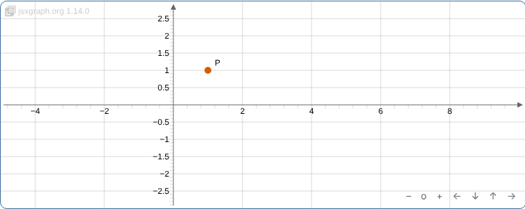 | 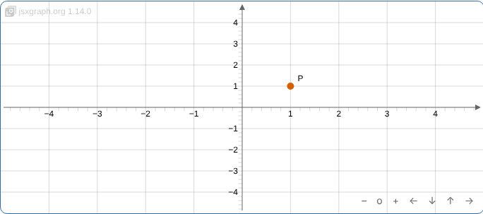 |
:::

Status lines with 1.14.0: created hidden `unitX 50, unitY 50, bounding box
[-5,3,-5,-3]`; after showing `unitX Infinity, bounding box [NaN,3,NaN,-3], P
on screen [NaN,100]`; after the resize `unitX 68.4, unitY 30, bounding box
[-5,5,5,-5]`.

**Cause** (source location from our investigation):

1. At creation, initBoard takes units and origin from the attributes
   ([`src/jsxgraph.js` 528–532](https://github.com/jsxgraph/jsxgraph/blob/v1.14.0/src/jsxgraph.js#L528-L532)).
   With a width of 0 the bounding box is degenerate (`xmin == xmax`, here
   [−5, 3, −5, −3]) but not NaN.
2. `updateContainerDims` re-initialises only a NaN bounding box
   ([board.js 4456](https://github.com/jsxgraph/jsxgraph/blob/v1.14.0/src/base/board.js#L4456)).
   So it calls `resizeContainer`, whose `setBoundingBox(box, …)` divides by
   `box[2] − box[0] = 0`: `unitX = Infinity`.
3. At the next resize the bounding box is NaN, and `updateContainerDims`
   re-initialises it from `this.attr.boundingbox`, which is the default
   [−5, 5, 5, −5] because the board was not given one.

**Possible fixes.**

1. In `updateContainerDims`, also re-initialise when the bounding box is
   degenerate (`bbox[2] − bbox[0] <= 0` or `bbox[1] − bbox[3] <= 0`), and for
   boards created with units and origin, re-initialise from those attributes
   rather than from the default `boundingbox`.
2. In initBoard, store the intended units and origin (or the bounding box
   they imply at the real size) so that a later re-initialisation can use
   them.
3. In an embedding: use `boundingbox`, or create the board only when its
   container is visible.

## 3. Library: a keepaspectratio board created at 0×0 shows the wrong region {#p3}

**What goes wrong.** A board with `keepaspectratio: true` and a bounding box
that is not square, created while its container is 0×0, shows a different
region once it is shown. Example: `boundingbox: [-1, 7, 13, -1]` in a
320×171 px frame shows x −7.1…19.1, y −4…10 instead of x −1.49…13.49,
y −1…7, so the figure is drawn about 1.75 times too small. The container is
0×0 at creation when its size is relative (percent width, `aspect-ratio`) and
its parent is `display:none`, and in every hidden iframe whose board div is
100%×100%, as with the Quarto extension. A container with a pixel width and
height is not affected, because JSXGraph reads the CSS pixel size of a hidden
element. With a square bounding box the right and the wrong rule give the
same region.

**Versions:** 1.9.2 to 1.14.0 as described. 1.6.2 to 1.9.1 show another
wrong region (here x −14.1…12.1, y 3…17); 1.5.0 leaves the bounding box NaN.

**Reproduce:** [keepaspectratio-hidden.html](repro/keepaspectratio-hidden.html).
Press **Show B and C** and compare (B) and (C) with (A). The result is the
same in every load and in all three Chromium variants. Checked by hand on
Windows Chrome 152 with 1.14.0: (A) [−1.49, 7, 13.49, −1], (B)
[−7.1, 10, 19.1, −4]. (C) tests this problem only if it is in view when
shown; an SVG of 0×0 in (C) means it was not painted at that moment, which
is problem 1, not this one.

You should see (B) and (C) like (A); you see the grey rectangle (the
bounding box) small in (B) and (C):

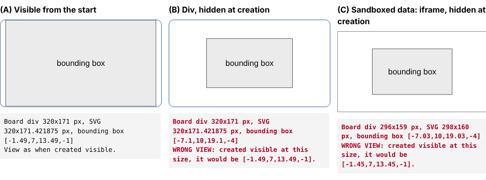

This problem was found and measured for this page; it was not part of the
independent verification.

**Cause** (from a trace of the board's units):

1. At creation in a 0×0 container, initBoard's keep-aspect rule
   ([`src/jsxgraph.js` 556–574](https://github.com/jsxgraph/jsxgraph/blob/v1.14.0/src/jsxgraph.js#L556-L574))
   computes `unitX = 0/14 = 0`, `unitY = 0/8 = 0` and then
   `unitX = (|unitY|·unitX)/|unitX| = NaN`. The board starts with
   `unitX = NaN`, `unitY = 0`.
2. When the container gets its size, `updateContainerDims`
   ([board.js 4456–4458](https://github.com/jsxgraph/jsxgraph/blob/v1.14.0/src/base/board.js#L4456-L4458))
   sees the NaN bounding box and calls
   `setBoundingBox(this.attr.boundingbox, this.keepaspectratio, 'keep')`.
   Its keep-aspect branch
   ([board.js 6445–6481](https://github.com/jsxgraph/jsxgraph/blob/v1.14.0/src/base/board.js#L6445-L6481),
   from [83ec5a4e5](https://github.com/jsxgraph/jsxgraph/commit/83ec5a4e5),
   2022-12-02, first in 1.5.0) decides which interval dominates from the
   previous units. `prev_w = ux * dx` is NaN, so `prev_w >= prev_h` is false,
   and the "switch dominating interval" branch (line 6466) sets
   `unitY = h / |dx|`: the width of the box is fitted into the frame's height.
   Traced in a hidden iframe with 1.14.0: created with `unitX NaN, unitY 0`;
   the call `setBoundingBox([-1,7,13,-1], true, 'keep')` sets
   `unitX = unitY = 27.86` for a 720×390 frame (390/14), giving
   [−6.92, 10, 18.92, −4].

**Possible fixes.**

1. In `updateContainerDims`, when the bounding box is NaN, set units and
   origin with initBoard's rule (jsxgraph.js 556–579) and the real size,
   instead of going through `setBoundingBox`. The board then gets the region
   it would have had if created visible. Narrow in scope. Tried as a monkey
   patch on 1.14.0: (B) then shows the same region as (A), also after the
   window is narrowed and widened.
2. In `setBoundingBox`, treat non-finite or zero previous units as "no
   previous view" and use the fit rule. Covers every caller, but changes a
   function used in many places.
3. In an embedding: create the board only once its container has a size.

## 4. Library: one exception during a resize stops all later resizing {#p4}

**What goes wrong.** If anything throws during a resize-triggered update
(for example a user function of a text or curve that fails once), JSXGraph
stops the board's ResizeObserver for good. From then on the board never
follows its container. The only trace is a `console.log` of the error
(1.11.1 and 1.14.0 log it; 1.9.2 and earlier log nothing).

**Versions:** 1.3.1 to 1.14.0 (verified in 1.3.1, 1.3.2, 1.9.1, 1.9.2,
1.11.1 and 1.14.0). 1.3.0 also stops following, through an uncaught error
that leaves `_isResizing` set.

**Reproduce:** [exception-stops-resize.html](repro/exception-stops-resize.html).
Nothing to click: the page resizes the container 600 → 500 → 400 → 700 →
300 px, and a text's content function throws once during the second resize.
The status lists each step. The reference link runs the same steps without
the error. Checked by hand on Windows Chrome 152 with 1.14.0: after the
resize in which the text throws, the SVG stays 400 px while the container
goes to 650 and 300 px.

::: {.table-responsive}
| You should see (without the error): the board follows to 300 px | You see: the SVG stays 400 px wide in the 300 px container |
|---|---|
| 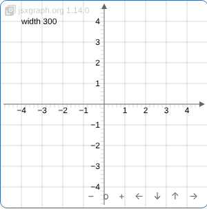 | 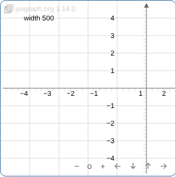 |
:::

**Cause** (source location from our investigation): the `catch` in
`startResizeObserver`,
[board.js 4505–4508](https://github.com/jsxgraph/jsxgraph/blob/v1.14.0/src/base/board.js#L4505-L4508)
(`JXG.debug(e); that.stopResizeObserver();`), added in
[46f210392](https://github.com/jsxgraph/jsxgraph/commit/46f210392)
(2021-09-13, "ResizeObserver: add try-catch", first in 1.3.1).

**Possible fixes.**

1. Log the error (as an error, not with `console.log`) and keep observing.
   A board whose update fails at every resize would then log at every
   resize.
2. Stop only after several consecutive failures.
3. Keep stopping, but report it with `console.error` or a board event, so
   the author can see why the board no longer follows.

## 5. Library: a keepaspectratio board narrowed below its box's aspect ratio is cropped {#p5}

This one concerns visible boards and may be intended. It is listed because
it looks like a defect on phones. Measured for this page (15 of 15 loads),
not part of the independent verification.

**What goes wrong.** A `keepaspectratio` board whose container changes from
wider-than-high to higher-than-wide keeps the box's vertical extent and
crops it at the sides. Example: `boundingbox: [-1, 7, 13, -1]` visible in a
718×388 px div, narrowed to 356×388 px, shows x 2…10 instead of the whole
x −1…13; the left and right parts of the figure are cut off. Widening
restores it. The container need not become higher than wide: as long as it
is wider than high, the vertical extent is kept, so the box is cropped as
soon as the container is narrower than the box's aspect ratio (example
below, 26 October).

**Versions:** measured in 1.12.2, 1.13.3 and 1.14.0 (automated Chromium; not
checked on Windows), and with the minimal page below also in 1.14.1 and
1.14.2; the code is from 1.5.0.

**Reproduce:** [keepaspectratio-narrowed.html](repro/keepaspectratio-narrowed.html)
(opens with 1.14.2; press **Narrow A**). It is a minimal page: `boundingbox:
[0, 6, 14, 0]` in a div 150 px high, created 600 px wide and narrowed to
273 px, against the same board created at 273 px. A is cropped to x
1.54…12.46 in 1.12.2, 1.13.3, 1.14.0, 1.14.1 and 1.14.2 (automated
Chromium, 26 October); the container stays wider than high throughout.
**Only after narrowing.** A board created at the narrow width is not
cropped: initBoard fits the whole box. Loaded directly at 430 or 340 px, the
pendulum figure (`boundingbox: [-1, 7, 13, -1]`, frame 390 px high) shows x
−1…13 in 1.14.0 and 1.14.2; created at 720 px and then narrowed to the same
widths, it shows x 1.59…10.41 and 2…10, with or without the figure's own
resize code, and the drawn figure (x 0…12) is cut. So a page opened on a
narrow screen is fine; the problem appears when the window is narrowed or a
phone is rotated after loading.
Earlier page: [JSXGraph 1.14.0 page with the course figures](library/jsxgraph-1.14.0.html),
pendulum in (a): open the page in a wide window, then make it narrow (about
390 px).

**Cause** in 1.14.2: on every resize `resizeContainer` re-applies the
current box with `setBoundingBox(box, keepaspectratio, 'keep')`
([board.js 5863–5864](https://github.com/jsxgraph/jsxgraph/blob/v1.14.2/src/base/board.js#L5863-L5864)),
and for a container wider than high `setBoundingBox` keeps the vertical
extent (`unitY = h / dy`) whatever the horizontal extent then needs
([board.js 6550–6560](https://github.com/jsxgraph/jsxgraph/blob/v1.14.2/src/base/board.js#L6550-L6560)).
Earlier location (from our investigation of 1.14.0): the "switch dominating
interval" branch of `setBoundingBox`'s keep-aspect logic,
[board.js 6461–6479](https://github.com/jsxgraph/jsxgraph/blob/v1.14.0/src/base/board.js#L6461-L6479)
(83ec5a4e5, 1.5.0).

**Possible fixes.** If cropping is not intended: fit the whole intended box
on resize (the rule initBoard uses), which needs the board to remember its
intended box. If it is intended: nothing; authors can size such boards with
`aspect-ratio` so the frame keeps its shape.

::: {.table-responsive}
| You should see: (B), created at 273 px | You see (1.14.2): (A), narrowed to 273 px |
|---|---|
| 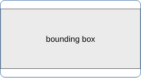 | 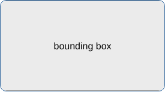 |
:::

## 6. Library: possible endless loop in the SVG renderer (found by reading, not run) {#p6r}

**What may go wrong.** In `src/renderer/svg.js`, the cubic Bézier branch
added by fe4342311 skips undefined points with `continue` inside a
`while (i < len)` loop, before `i` is incremented
([svg.js 1250–1254 in v1.14.0](https://github.com/jsxgraph/jsxgraph/blob/v1.14.0/src/renderer/svg.js#L1250-L1254)):

```js
} else if (el.bezierDegree === 3) {
    i = 0;
    while (i < len) {
        if (el.points[i] === undefined) {
            continue;          // i is not incremented: the loop does not end
        }
        ...
        i += 1;
    }
}
```

If a curve with `bezierDegree` 3 ever has an undefined point, the page hangs.
This was found by reading the code during the verification; it was not
triggered or tested.

**Possible fix.** Increment `i` before `continue`, or use a `for` loop as the
`bezierDegree === 1` branch does (line 1161), where `continue` is safe.

## 7. Extension: after the first resize, boards no longer follow the window {#p6}

**What goes wrong.** With jsxgraph-quarto's upstream main, a board stops
following the window after its first size change. A board shown from a
hidden tab keeps the width it had when shown: narrowed to phone width, it
stays 727 px wide in a 267 px frame and gets a scrollbar. A visible board
that was narrowed does not grow back: it stays 339 px wide in a 760 px frame.
(These pixel figures are from the linked test page; not independently
verified.)
Library problem 1 also applies (problem 8).

**Versions:** jsxgraph/jsxgraph-quarto main
[59d549c](https://github.com/jsxgraph/jsxgraph-quarto/commit/59d549c)
(introduced in e9d575b, pull request #1). Not in a26aea8.

**Reproduce:** [test page built with 59d549c](extension-59d549c/index.html).
Open it in a wide window, open **2025 → Prøve 4**, then narrow the window to
about 390 px. Compare with [a26aea8](extension-a26aea8/index.html).
Measured in Chromium with a window and headless, 20 page loads each: the
board did not follow narrowing in 20 of 20.

**Cause.** The extension's `refreshBoards()` calls
`board.resizeContainer(width, height)` with the default `dontset = false`
([`_extensions/jsxgraph/lua/jsxgraph.lua` 595–610](https://github.com/jsxgraph/jsxgraph-quarto/blob/59d549c/_extensions/jsxgraph/lua/jsxgraph.lua#L595-L610)).
That writes `width: 727px; height: 320px` into the board div's style (as
documented for `resizeContainer`, board.js 5776–5778), so the div no longer
follows the iframe, and neither JSXGraph's ResizeObserver nor the extension
sees a new size.

**Possible fixes.** Leave the sizing to JSXGraph's ResizeObserver; or call
`resizeContainer(w, h, true)` (or `updateContainerDims()`), which do not set
the div's CSS size. [Pull request #2](https://github.com/jsxgraph/jsxgraph-quarto/pull/2)
does this.

## 8. Extension: boards in hidden tabs can stay blank (library problem 1) {#p7}

This is library problem 1 as it shows in Quarto pages.

**What goes wrong.** The extension puts each board into a sandboxed `data:`
iframe. A board in a tab that is hidden at load can stay blank after the
tab is opened, under the same condition as the iframe page of problem 1:
Chrome is not painting the window at that moment (covered, in the
background, headless or automated). It was not checked by hand on Windows
with the extension's pages.

**Versions:** jsxgraph-quarto a26aea8 and 59d549c. Measured by the
independent verification in Chromium 141 on Linux under automation, 20 page
loads each, tab opened after load:
a26aea8 (its bundled JSXGraph 1.13.3) blank in 11/20 headless and 15/20 with
a window; 59d549c (JSXGraph 1.14.0) in 7/20 and 11/20; 17de83e, an earlier
state of pull request #2 that turned JSXGraph's observer off, in
0/20 and 0/20. The headless shell: 0/20 for all three. In the 59d549c runs
the extension's own `resizeContainer` call gives the SVG the right size, but
the bounding box stays NaN, so the board draws nothing; it stays so after
narrowing and widening. With a26aea8 the board recovers at the first later
resize of the iframe.

**Reproduce:** [test page built with a26aea8](extension-a26aea8/index.html),
tab **2025 → Prøve 4**. By hand this needs the tab to open while Chrome is
not painting the window, which is hard to arrange; the iframe page of
problem 1 with its 20-trial button is the easier way.

**Fix.** In the library: problem 1. In the extension until then: the
`resize` workaround shown under problem 1. The current state of
[pull request #2](https://github.com/jsxgraph/jsxgraph-quarto/pull/2)
keeps JSXGraph's observer and adds this workaround; see the pull request for
its approach. In our own measurement of it (not independently verified)
there were 0 blank boards among 600 hidden boards: 20 loads of a page with
40 boards, 30 of them hidden.

## Fixed in later JSXGraph versions {#fixed}

For completeness, and because older versions are still in use. Each item
can be seen with a test page and the version link on it. The first item was
checked by the independent verification; the others were measured for this
page with the linked pages.

**1.13.0 and 1.13.1: `functiongraph` with an interval throws in a board
created hidden.** `board.create('functiongraph', [f, -2, 3])` in a container
0 px wide, without a CSS pixel width (for example `width: 100%`, as in
Quarto), throws `TypeError: Cannot read properties of undefined (reading
'usrCoords')`, so the rest of the page's script does not run (here: point B
is missing). Not when the board is created visible, and not when the
hidden container has an inline pixel width. Fixed in 1.13.2 by
[fe4342311](https://github.com/jsxgraph/jsxgraph/commit/fe4342311)
(2026-08-05, "Bug fix: plotting while the division has display:none").
Page: [functiongraph-interval-hidden.html](repro/functiongraph-interval-hidden.html)
(opens with 1.13.1; press **Show**). Checked by hand on Windows Chrome 152:
1.13.1 throws the TypeError and creates neither the functiongraph nor B;
1.13.2 creates all three without errors.

::: {.table-responsive}
| 1.13.2: A, the segment and B | 1.13.1: only A, then the exception |
|---|---|
| 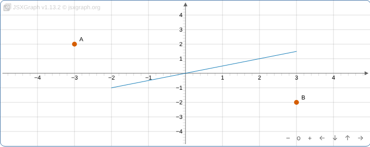 | 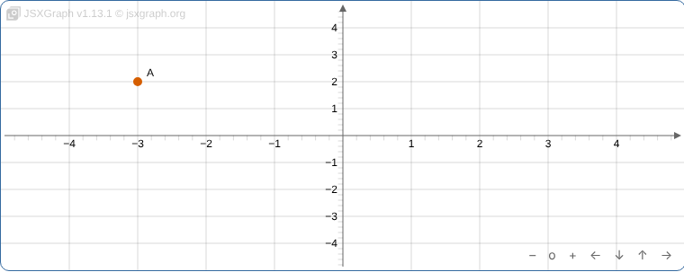 |
:::

**1.6.0 to 1.9.1: boards created hidden show a shifted region.** A board with
`boundingbox: [-5, 5, 5, -5]` created in a container 0 px wide (relative
width in a hidden parent, or a hidden iframe) shows x −10…0 after it is shown,
and keeps the wrong region through later resizes. Introduced by fa0b02ffa
(1.6.0, sizes clamped to `Mat.eps`), removed by 77cbd7add (1.9.2). Page:
[created-hidden.html?v=1.9.1](repro/created-hidden.html?v=1.9.1), press
**Show B and C**.

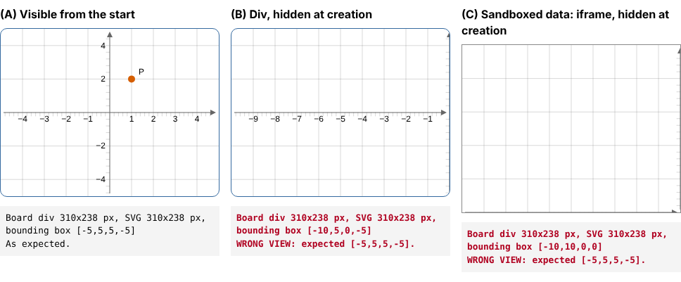

**1.5.0: `keepaspectratio` boards created hidden stay empty** (their bounding
box stays NaN). Page:
[keepaspectratio-hidden.html?v=1.5.0](repro/keepaspectratio-hidden.html?v=1.5.0).

**1.4.4: the ResizeObserver does not work at all.** `updateContainerDims`
throws `TypeError: d.isNaN is not a function` at every call, which stops the
observer (problem 4), so no board follows resizing and boards created hidden
stay empty. Fixed in 1.4.5 by
[02cae89f6](https://github.com/jsxgraph/jsxgraph/commit/02cae89f6)
("Fix regression: ResizeObserver was broken in v1.4.4"). Page:
[created-hidden.html?v=1.4.4](repro/created-hidden.html?v=1.4.4).

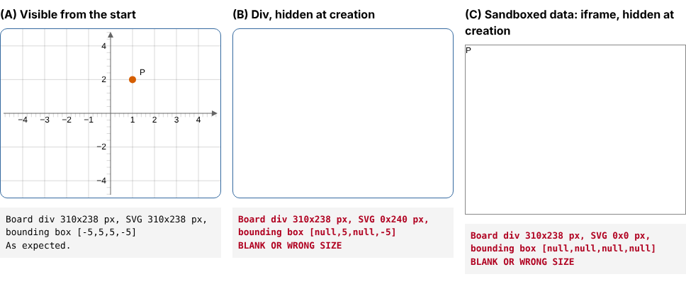

**1.3.0: the SVG is 2 px larger than its container**, also for visible
boards (here a 318×238 div gets a 320×240 SVG). Page:
[created-hidden.html?v=1.3.0](repro/created-hidden.html?v=1.3.0).

**1.2.3 and earlier: no automatic resizing.** There is no ResizeObserver
yet, so a board created hidden stays 0 px wide when shown. Page:
[created-hidden.html?v=1.2.3](repro/created-hidden.html?v=1.2.3).

## Test pages with the course's figures

Besides the minimal pages, these pages use the course's own figures (from
aacchhee/ctm-demo, fetched by commit), so that the problems can be seen in
the setting where they were first noticed:

- plain HTML, no Quarto, one page per JSXGraph version:
  [1.12.2](library/jsxgraph-1.12.2.html),
  [1.13.3](library/jsxgraph-1.13.3.html),
  [1.14.0](library/jsxgraph-1.14.0.html). A solenoid
  (`keepaspectratio: false`) and a pendulum (`keepaspectratio: true`), each
  (a) visible, (b) in a hidden div, (c) in a hidden `data:` iframe; press
  **Show**.
- Quarto pages with nested tabs, one per extension version, all with
  JSXGraph 1.14.0: [a26aea8](extension-a26aea8/index.html) (before pull
  request #1), [59d549c](extension-59d549c/index.html) (main),
  [17de83e](extension-17de83e/index.html) (an earlier state of pull
  request #2; see the pull request for the current approach).

Measured on the plain HTML pages in Chromium with a window, 5 page loads per
version (1.12.2, 1.13.3, 1.14.0), **Show** pressed 2.5 s after load, then the
window narrowed to 390 px and widened to 1200 px:

- the solenoid filled its frame with the intended view at every step in
  (a), (b) and (c), in all 15 loads;
- the pendulum in (c) showed the wrong region of [problem 3](#p3) after
  showing and after widening (15 of 15), and the right one when narrowed;
- the pendulum in (a) and (b) was cropped when narrowed ([problem 5](#p5),
  15 of 15);
- no board was blank in these loads.

For the Quarto pages, see the measurements under [problem 7](#p6) and
[problem 8](#p7).

## About this page

Built by `scripts/build-jsxgraph-repro.sh` in aacchhee/ctm-demo, in the
workflow step "Build the temporary JSXGraph reproduction (old commits)". The
minimal pages in `repro/` are plain HTML kept in that repository; the course
figures and the three extension versions are fetched by commit when the page
is built. The course pages do not link here.

