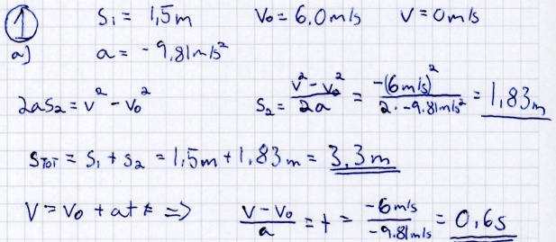

::: {.lund-lead}
How can AI help with the mathematics students are **actually studying**?
:::

## The frame {#frame .lund-part data-part="0"}

::: {.lund-big}
For the next ten years, the social contract still holds.
:::

- Universities **certify**: a degree says the candidate passed the exams.
- Knowledge is **chunked**: a programme into courses, a course into topics.
- AI or not, the lower-level chunks will most likely survive.

::: {.lund-nest}
::: {.lund-box}
**Study programme**

::: {.lund-box}
**Course**

::: {.lund-box}
**Topic**

[Definition]{.lund-chip} [Notation]{.lund-chip} [Example]{.lund-chip} [Method]{.lund-chip} [Exercise]{.lund-chip}
:::
:::
:::
:::

::: {.lund-cols}
::: {.lund-card .lund-inside}
### Inside the course

Our definitions, our notation, our examples, our methods, what is assessed.
:::

::: {.lund-card .lund-outside}
### Outside the course

Everything else: other books, other conventions, other levels.
:::
:::

## The course knows what matters {#course .lund-part data-part="1a"}

::: {.lund-big}
Two derivatives. Both correct mathematics. Which one belongs in **this** course?
:::

::: {.lund-cols}
::: {.lund-card}

:::

::: {.lund-card}

:::
:::

::: {.lund-question}
The lecturer knows which one is relevant. **Does the model?**
:::

## One problem, one button {#one-button .lund-part .lund-sub data-part="1b"}

::: {#lund-connection}
:::

::: {#lund-two-frames}
:::

## Same question, two models {#two-models .lund-part .lund-sub data-part="1c"}

::: {#lund-two-models}
:::

## Same models, with the course {#with-course .lund-part .lund-sub data-part="1d"}

::: {#lund-course-frame}
:::

## What we can turn {#turn .lund-part .lund-sub data-part="1e"}

::::: {.lund-steps}
::: {.lund-step}
**The model**\
small or large, thinking or not
:::
::: {.lund-step}
**The prompt**\
what we ask, and how
:::
::: {.lund-step .lund-step-key}
**The course**\
what is inside, what is outside
:::
:::::

::: {.lund-question}
The first two are settings. The third we have to **define**, somehow.
:::

## Retrieval-Augmented Generation {#rag .lund-part data-part="2"}

::: {.lund-big}
One way to define the course for a model: let it read the course.
:::

The simplest way: upload the course PDF to a chat. It works, more or less.

::: {.lund-problems}
::: {.lund-problem}
**Soup**\
formulas and figures get lost on the way ([3c](#pdf))
:::
::: {.lund-problem}
**Everything, every time**\
the whole course goes along with each question; slow, and details get lost
:::
::: {.lund-problem}
**A frozen copy**\
change the course, and every uploaded copy is out of date
:::
::: {.lund-problem}
**Inside and outside mixed**\
nothing shows where the PDF ends and the model's own knowledge begins
:::
::: {.lund-problem}
**Somebody else's server**\
course material and questions go to a commercial provider
:::
:::

RAG does the reading for us, from clean course pages:

::::: {.lund-steps .lund-steps-compact}
::: {.lund-step}
**Retrieve**\
find the passages of the course that fit the question
:::
::: {.lund-step}
**Augment**\
hand those passages to the model with the question
:::
::: {.lund-step}
**Generate**\
the model answers from them, and names the sections it used
:::
:::::

```{mermaid}
%%| fig-width: 9
%%{init: {"themeVariables": {"fontSize": "18px"}}}%%
flowchart LR
  S([Student asks]) --> L["Librarian<br/>finds the right passages"]
  L --> M["Language model<br/>writes the answer"]
  M --> A([Answer + the sections it used])
  C[(The course,<br/>in short passages)] --- L
  classDef course fill:#fff8ec,stroke:#e8a33d
  classDef model fill:#eaf6ee,stroke:#2e8b57
  classDef student fill:#eef5fd,stroke:#2780e3
  class C,L course
  class M model
  class S,A student
```

### What lives where

::: {.lund-where}
::: {.lund-place .is-github}
**The course pages**\
where the teacher writes them: GitHub
:::
::: {.lund-place .is-server}
**The librarian and the passages**\
a small server at NTNU; updated whenever the course changes
:::
::: {.lund-place .is-cluster}
**The language model**\
Idun, NTNU's large computing cluster; nothing leaves NTNU
:::
::: {.lund-place .is-browser}
**The student**\
only a web browser
:::
:::

::: {.lund-question}
**Inside first**: the answer comes from the course passages, and names their sections.
**Outside if needed**: anything else comes after, clearly labelled.
:::

[Open the course assistant](){.btn .btn-primary .btn-lg .lund-cta target="_blank"}

## One source, two uses {#source .lund-part data-part="3a"}

::: {.lund-big}
The lecturers write the course once. Students read it; the assistant reads it too.
:::

```{mermaid}
%%| fig-width: 9
%%{init: {"themeVariables": {"fontSize": "18px"}}}%%
flowchart LR
  T(["Lecturers"]) --> Q["Course pages<br/>text · mathematics · code"]
  Q --> G[("GitHub<br/>every change saved")]
  G --> W(["Website<br/>for students"])
  G --> P(["Passages<br/>for the assistant"])
  classDef people fill:#eef5fd,stroke:#2780e3
  classDef source fill:#f3f0fa,stroke:#6f42c1
  class T,W,P people
  class Q,G source
```

::: {.lund-cols}
::: {.lund-card}
### No "AI version" of the course

There is only the course.
:::

::: {.lund-card}
### Fix it once

A corrected sign or new notation reaches the website and the assistant together.
:::
:::

## Data and its representation {#data .lund-part .lund-sub data-part="3b"}

::: {.lund-big}
Write what the mathematics **is**. Let the tools decide how it **looks**.
:::

::: {.lund-cols .lund-data}
::: {.lund-card .lund-data-source}
#### Markdown: what the lecturer writes

````markdown
```{math-exercise}
#| label: lund-derivative-course
#| vars: x
Differentiate $f(x)=\sqrt{x^2+1}$.
$f'(x)=$ __[x/sqrt(x^2+1)]
```
````

A few lines: the task, the answer, the check. Nothing else.
:::

::: {.lund-card .lund-data-html}
#### HTML: what the browser gets

::: {#lund-html-monster}
:::

Messy, huge, never written by hand. Rendered, it looks good:
the exercise in [part 1](#course).
:::
:::

Representations of the same data:

- the web page with an answer field and **Check**
- feedback and similar problems from an AI model
- a passage the assistant reads
- a printed exam, or next year's new layout

## PDF: one big soup {#pdf .lund-part .lund-sub data-part="3c"}

A PDF keeps only how the page **looks**. Text, formulas, figures and page
numbers melt into one layer. Copy the text out of our physics practice exam:

::: {.lund-soup}
| On the page | Copied out of the PDF | In our Markdown |
|---|---|---|
| $3{,}93\cdot10^{26}\,\mathrm{W}$ | `3,93 ⋅ 1026 W` | `$3{,}93\cdot10^{26}\,\mathrm{W}$` |
| $4{,}50\cdot10^{23}$ molekyler | `4,50 ⋅ 1023 molekyler` | `$4{,}50\cdot10^{23}$ molekyler` |
| $U_1=150\,\mathrm{V}$ | `𝑈𝑈1 = 150 V` | `$U_1=150\,\mathrm{V}$` |
| the figure | *(nothing)* | `` |
:::

The power of a star became 1026 watts: one microwave oven.

::: {.lund-cols}
::: {.lund-card .lund-outside}
### Late: start from the PDF

Special models exist just to guess the structure back
(Idun runs one, GLM-OCR). They help, and they still slip in the mathematics.
:::

::: {.lund-card .lund-inside}
### Early: start from the data

Write Markdown from the start. The PDF becomes one more representation,
and the guessing step disappears.
:::
:::

## Paper and Python {#paper .lund-part .lund-sub data-part="3d"}

Here we touch a human–machine problem: the same mathematics looks completely
different on paper and in Python. The ball problem from our practice exam:

::: {.lund-cols .lund-paper}
::: {.lund-card}
#### On paper: how students think

{fig-alt="A student's handwritten solution: a ball thrown up from 1.5 m at 6.0 m/s. The student finds the extra height 1.83 m, the total height 3.3 m and the time 0.6 s, with units throughout."}
:::

::: {.lund-card}
#### Typed: what the machine checks

```python
t = 6.0/9.81
h = 1.5 + 6.0**2/(2*9.81)
```

No units, no sketch, no crossed-out first attempt.
:::
:::

::: {.lund-big}
Language models can now read the paper.
:::

<!-- Parked for later (left out to keep the focus on paper vs Python):
"surrogate input" - drawing instead of typing. Example: sketch a
non-decreasing function freehand on a JSXGraph board and have it checked.
Source: Erasmus-CTM/math-exercise, examples.qmd, section "JSXGraph response -
freehand drawing and polynomial approximation", label
ex-jsxgraph-freehand-monotonicity. -->

A photo of the working gets step-by-step hints:
[try it in part 4](#assessment), or the
[whole practice exam](pages/handwriting-ai.qmd).

::: {.lund-question}
The data lasts; representations change. Keep the border clear,
and no tool, platform or model owns the course.
:::

## Many lecturers, one course {#lecturers .lund-part .lund-sub data-part="3e"}

::: {.lund-history}
- [Lecturer A]{.who} changes the vector notation in week 3
- [Lecturer B]{.who} adds an exercise on eigenvalues
- [Lecturer C]{.who} reads both changes and approves them
- [Published]{.who .is-done} the website and the assistant follow the same day
:::

::::: {.lund-steps}
::: {.lund-step}
**Who changed what**\
and when, for every line
:::
::: {.lund-step}
**Propose, review, publish**\
nothing goes live unread
:::
::: {.lund-step}
**Go back**\
to any earlier version, or last year's
:::
:::::

[In GitHub's words: commits, pull requests, history.]{.lund-small}

## Open source {#open-source .lund-part .lund-sub data-part="3f"}

::::: {.lund-steps}
::: {.lund-step}
**Free tools**\
Quarto, Pyodide, JSXGraph, CTM Assessment
:::
::: {.lund-step}
**Plain text files**\
readable in ten years, by any tool and any model
:::
::: {.lund-step}
**Share and reuse**\
between courses and between universities
:::
:::::

::: {.lund-question}
The course belongs to its lecturers, not to a platform.
:::

## Assessment: deterministic and stochastic {#assessment .lund-part data-part="4a"}

::: {.lund-big}
We combine two kinds of assessment.
:::

::: {.lund-cols}
::: {.lund-card .lund-inside}
### Deterministic: the check

Written down. The same answer gives the same result, every time.
Runs in the student's browser, Python included.
:::

::: {.lund-card .lund-outside}
### Stochastic: the AI

Reads the task, the answer, the course and the check result, then suggests
the next step. It can vary, and it can be wrong.
:::
:::

::: {.lund-question}
The check decides what is correct. The AI helps with what comes next.
:::

::: {.panel-tabset}

## A checked problem



## Python with tests



## Handwritten work {#handwriting}

::: {#fyll-inn-verktoy}
:::



:::

## With AI, the teacher has to be explicit {#prompts .lund-part .lund-sub data-part="4b"}

::: {.lund-prompts}
::: {.lund-card}
#### How to help (every problem)

```yaml
handwriting:
  language: English
  allow-full-solution: false
  steps:
    - Level 1, assessment: point to the mistake, do not give correct values.
    - Level 2, explanation: which law applies; no numbers, no final answer.
    - Level 3, method: numbered steps, stop before the numbers.
    - Level 4, worked solution.
```
:::

::: {.lund-card}
#### What to know (this problem)

```yaml
v25-1a:
  base-prompt: >-
    Reference: at the top the velocity is zero. t = v0/g = 0.61 s.
    The rise is v0²/(2g) = 1.83 m, so the height is 1.5 m + 1.83 m = 3.3 m.
    Typical mistakes: forgets the initial height; mixes up the signs of
    g and v0; answers only one of the questions; rounds too early.
```
:::
:::

[Shortened from the prompt files of the practice exam. Teachers can edit them
live in the prompt sandbox at the [bottom of this page](#prompt-sandkasse).]{.lund-small}

::: {.lund-big}
This is a new kind of knowledge about problems: what a good answer looks like,
the typical mistakes, which hint comes first, and what must not be revealed.
:::

::::: {.lund-steps}
::: {.lund-step}
**The task**\
what the student sees
:::
::: {.lund-step}
**The check**\
deterministic, written down
:::
::: {.lund-step .lund-step-key}
**The prompt**\
the teacher's knowledge, made explicit
:::
:::::

## More practice, on request {#practice .lund-part data-part="5"}

::: {.lund-big}
Easier, another one like this, harder: the model writes new problems.
:::

::: {.lund-nest .lund-space}
::: {.lund-box .is-all}
**Everything a model can write**

::: {.lund-box .is-near}
**Near the course**: built from the original exercise and the retrieved course pages

::: {.lund-box .is-ours}
**Written and checked by us**
:::
:::
:::
:::

::: {.lund-question}
RAG shrinks the space the model draws from. Still, we **give away control**
in exchange for a **richer problem space**.
:::

::: {.lund-cols}
::: {.lund-card}
### Is it relevant?

- built from the original exercise and the nearby course pages
- the teacher writes what "harder" and "easier" mean for this exercise
- every new problem starts from the original, so there is no drift
:::

::: {.lund-card}
### Is it solved correctly?

- the model writes the problem; computer algebra computes the answer
- otherwise a second, independent solve, or the label "unverified answer key"
- students can flag a key; it never counts toward grades, and is off in exams
:::
:::

Try **Similar problem** on the derivatives in [part 1](#course), or the quiz mode in the course assistant.

[Open the course assistant](){.btn .btn-outline-primary .btn-lg .lund-cta target="_blank"}

::: {.lund-question}
"Harder" is the model's reading of difficulty.
How it matches what **this** learner finds hard is an open question.
:::

## The point {#point .lund-part}

::: {.lund-takeaways}
- [0–1]{.lund-num} Model and prompt are settings. **The course** we have to define.
- [2]{.lund-num} **Let the model read the course**: inside first, outside clearly labelled.
- [3]{.lund-num} **The data lasts**; representations change.
- [4]{.lund-num} **The check decides** what is correct; the AI helps with what comes next.
- [5]{.lund-num} We **give away control** in exchange for a richer problem space.
:::
